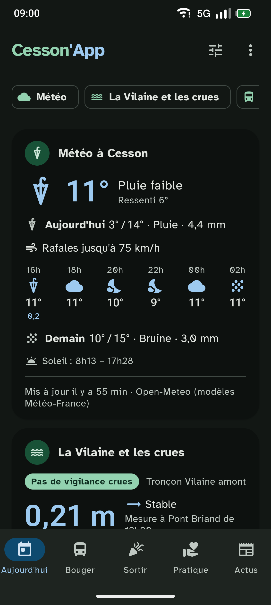
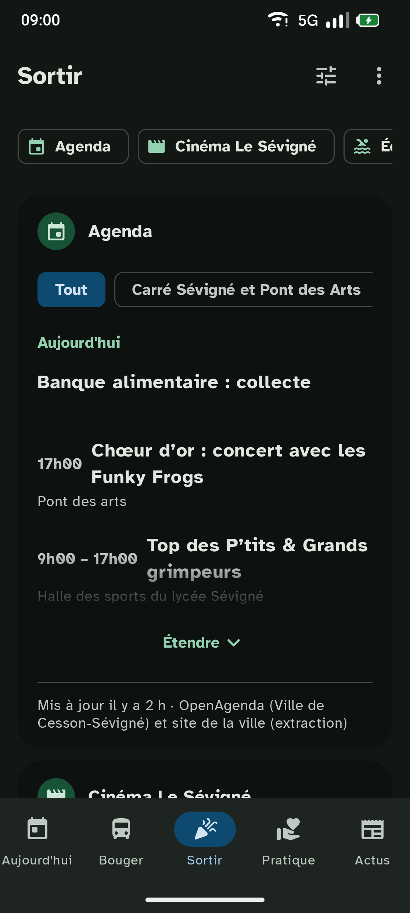
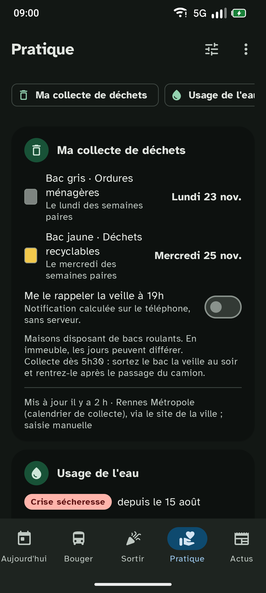
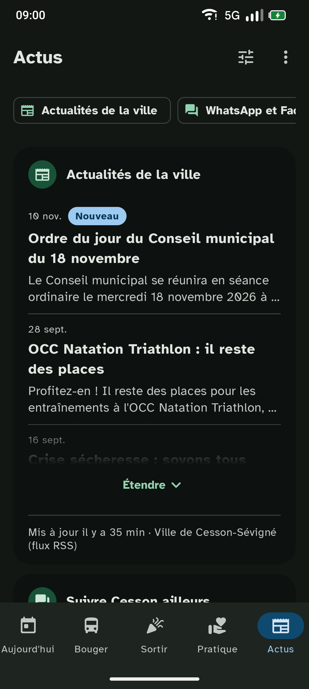

# Cesson'App

Cesson'App (« Cesson au quotidien ») : app Android non officielle (Yogi Studio) qui regroupe l'information pratique de Cesson-Sévigné à
partir de données publiques. Aucun compte, aucune publicité, aucune donnée collectée.
Architecture : voir « Cesson au quotidien — Document d'architecture.md ».

## Backend (collecteurs Python → fichiers JSON statiques)

    cd backend
    python3 -m venv .venv && .venv/bin/pip install -e '.[dev]'
    .venv/bin/pytest                                  # tests
    .venv/bin/python -m cesson collecter vilaine      # publie public/vilaine.json + manifest.json
    .venv/bin/python -m cesson sante                  # tableau de santé des sources
    .venv/bin/python -m cesson schemas                # régénère schemas/*.json (contrat avec l'app)

Planification et service : `backend/deploy/crontab`, `backend/deploy/nginx.conf`.

### Hébergement sur un Raspberry Pi 4 (coût nul)

1. Raspberry Pi Imager : *Raspberry Pi OS Lite (64-bit)*, version Trixie ; nom d'hôte `cesson-pi`,
   ta clé SSH. Ethernet de préférence.
2. Depuis le PC : `backend/deploy/raspberry/envoyer.sh` (même commande pour chaque mise à jour).
   Le script installe le backend, nginx en local, le cron, et publie par Tailscale Funnel
   (compte Tailscale gratuit, lien de connexion affiché au premier lancement).
3. Il affiche l'adresse publique (`https://cesson-pi.….ts.net/`, à passer en `-Pcesson.donneesUrl`)
   et le sujet ntfy à suivre pour les alertes.

## App Android

    cd android
    ./gradlew testDebugUnitTest assembleDebug

En debug, l'app lit `http://127.0.0.1:8000/`. Pour tester sur un téléphone branché en USB :

    python3 -m http.server -b 127.0.0.1 -d backend/public 8000
    adb reverse tcp:8000 tcp:8000

Release : `./gradlew :app:assembleRelease :app:bundleRelease`. L'adresse des données et le contact sont dans
`android/gradle.properties` ; la clé d'envoi Play Store est lue dans `~/.config/cessonapp/upload-key.properties`
(jamais dans le dépôt ; sans elle, la release n'est pas signée).

## Carte de l'intro

La carte vectorielle de Cesson-Sévigné animée au lancement vient d'OpenStreetMap (ODbL). Pour la régénérer :

    curl -s --data-urlencode data@tools/carte/requete.overpassql https://overpass-api.de/api/interpreter > osm.json
    python3 tools/carte/generer_carte.py osm.json android/app/src/main/java/com/yogistudio/cesson/ui/intro/CarteCesson.kt

## Licence

Cesson'App est un logiciel libre, publié par Yogi Studio sous licence **GNU GPL v3** (voir `LICENSE`), comme
Molkky Board et VYLIA. Les données affichées restent sous la licence de leurs producteurs (ODbL, Licence
Ouverte…), citées dans l'app (écran Sources et licences) et dans le générique.
