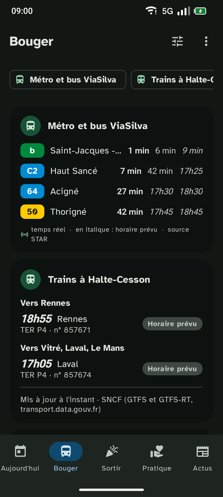

# Cesson'App

Cesson'App (« Cesson au quotidien ») : app Android libre et non officielle (Yogi Studio) qui regroupe l'information
pratique de Cesson-Sévigné à partir de données publiques. Aucun compte, aucune publicité, aucune donnée collectée.

- **Android** : APK de la [dernière version](https://github.com/GuillaumeCHR/cesson-quotidien/releases/latest).
- **iPhone et ordinateur** : [version web](https://guillaumechr.github.io/cesson-quotidien/), installable, sans les
  notifications ni le widget.
- Architecture : voir « Cesson au quotidien — Document d'architecture.md ».

## Ce que fait l'app

- **Aujourd'hui** : météo et vigilance Météo-France, Vilaine et Vigicrues, prochains métros et bus, trains à la halte,
  circulation, collecte des déchets, équipements ouverts ou fermés, qualité de l'air et pollens, actualités de la ville.
- **Bouger** : pôle ViaSilva, parc relais en temps réel, mon arrêt de bus, trains, circulation, carburants, bornes.
- **Sortir** : saison culturelle du Carré Sévigné et du Pont des Arts (vignettes, « Complet », billetterie), cinéma
  Le Sévigné (séances et fiche de chaque film : affiche, réalisateur, durée, résumé), agenda, équipements.
- **Familles** : menus de la cantine, vacances scolaires, infos du portail familles.
- **Pratique** : déchetterie, pharmacies, urgences, défibrillateurs, accessibilité des lieux, urbanisme, démarches.
- **Notifications calculées sur le téléphone**, sans serveur de notification : collecte la veille, vigilance météo,
  pollens et pollution, passage du bus, **trains habituels** (retard de 5 min ou plus, suppression) et **spectacles
  favoris** (rappel la veille).
- **Guide de démarrage** : vos déplacements (voiture, bus et métro, train) règlent l'accueil et l'onglet Bouger ;
  cartes compactes ou détaillées ; cartes de l'accueil, de Sortir (et vos équipements) et d'Environnement (avec le rappel
  de collecte et les alertes) ; tous les onglets se réordonnent.

## Backend (collecteurs Python → fichiers JSON statiques)

    cd backend
    python3 -m venv .venv && .venv/bin/pip install -e '.[dev]'
    .venv/bin/pytest                                  # tests
    .venv/bin/python -m cesson collecter vilaine      # publie public/vilaine.json + manifest.json
    .venv/bin/python -m cesson sante                  # tableau de santé des sources
    .venv/bin/python -m cesson schemas                # régénère schemas/*.json (contrat avec l'app)

Planification et service : `backend/deploy/crontab`, `backend/deploy/nginx.conf`.

### Hébergement sur un Raspberry Pi 4 (coût nul)

1. Raspberry Pi Imager : *Raspberry Pi OS Lite (64-bit)*, version Trixie ; nom d'hôte `cesson-pi`,
   ta clé SSH. Ethernet de préférence.
2. Depuis le PC : `backend/deploy/raspberry/envoyer.sh` (même commande pour chaque mise à jour).
   Le script installe le backend, nginx en local, le cron, et publie par Tailscale Funnel
   (compte Tailscale gratuit, lien de connexion affiché au premier lancement).
3. Il affiche l'adresse publique (`https://cesson-pi.….ts.net/`, à passer en `-Pcesson.donneesUrl`)
   et le sujet ntfy à suivre pour les alertes.
4. Ensuite, le Pi se met à jour seul depuis GitHub, toutes les heures, une fois les tests du commit réussis.

Identifiants des API à compte, saisis à la main dans `/srv/cesson/secrets/` (root:cesson, 640), jamais dans le dépôt :
`atmo.env` (Atmo Data), `meteofrance.env` (vigilance), `acceslibre.env`, `star.env`, `rennes.env` (« cle_api=… », compte data.rennesmetropole.fr :
circulation et déchèterie, sinon quota anonyme de l'adresse IP) et `tmdb.env` (« jeton=… », jeton
d'accès en lecture TMDB, pour les fiches des films). Sans l'un d'eux, seul le module concerné reste vide ou incomplet.
Les affiches des films et les vignettes des spectacles sont téléchargées par le Pi : les téléphones ne contactent
ni TMDB ni OpenAgenda.

## App Android

    cd android
    ./gradlew testDebugUnitTest assembleDebug

L'app lit les données à l'adresse `cesson.donneesUrl` de `android/gradle.properties` (le Pi). Sans elle, la version
debug lit `http://127.0.0.1:8000/` ; pour tester ainsi sur un téléphone branché en USB :

    python3 -m http.server -b 127.0.0.1 -d backend/public 8000
    adb reverse tcp:8000 tcp:8000

Release : `./gradlew :app:assembleRelease :app:bundleRelease`. L'adresse des données et le contact sont dans
`android/gradle.properties` ; la clé d'envoi Play Store est lue dans `~/.config/cessonapp/upload-key.properties`
(jamais dans le dépôt ; sans elle, la release n'est pas signée).

## Version web

Dossier `web/` : HTML, CSS et JavaScript sans framework ni compilation, publiés sur GitHub Pages à chaque envoi sur
`main`. Elle lit les mêmes JSON que l'app (le Pi les sert avec `Access-Control-Allow-Origin: *`). Changer `VERSION`
dans `web/sw.js` à chaque modification, pour que les navigateurs reprennent les nouveaux fichiers.

## Carte vectorielle de Cesson

La carte de Cesson-Sévigné animée au lancement, qui sert aussi de fond au plan de la circulation (app et version web),
vient d'OpenStreetMap (ODbL). Pour la régénérer :

    curl -s -A "CessonApp-carte/1.0" --data-urlencode data@tools/carte/requete.overpassql https://overpass-api.de/api/interpreter > osm.json
    python3 tools/carte/generer_carte.py osm.json android/core/src/main/java/com/yogistudio/cesson/core/carte/CarteCesson.kt web/carte-cesson.js

## Licence

Cesson'App est un logiciel libre, publié par Yogi Studio sous licence **GNU GPL v3** (voir `LICENSE`), comme
Molkky Board et VYLIA. Les données affichées restent sous la licence de leurs producteurs (ODbL, Licence
Ouverte…), citées dans l'app (écran Sources et licences) et dans le générique.

Fiches des films : [The Movie Database (TMDB)](https://www.themoviedb.org/) et Wikidata (CC0). This product uses the
TMDB API but is not endorsed or certified by TMDB. Vignettes des spectacles : OpenAgenda (Ville de Cesson-Sévigné),
avec le crédit de chaque photo.
